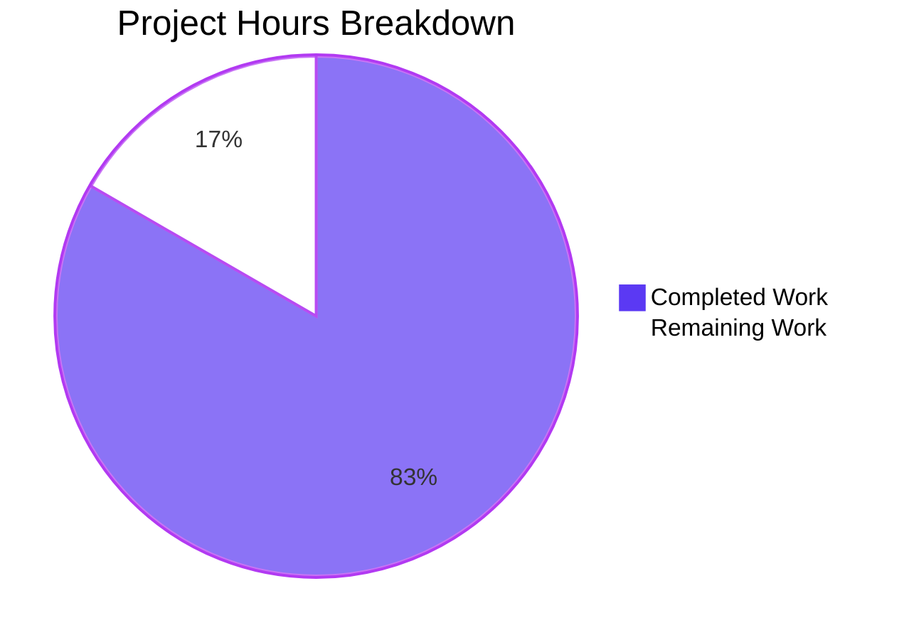

# 1. Executive Summary

## 1.1 Project Overview

The project delivers one Python script, `Welcome.py`, at the repository root that prints `Welcome to Blitzy` to standard output and exits successfully. It is the whole product: no configuration, input, state, dependency or deployment target. The file is one `print` statement — 27 bytes, ASCII, one trailing newline — built to the instruction that the code be simple: no import, shebang, entry-point guard, docstring, comment, type hint, parser, logging or error handling. Developers, reviewers and stakeholders run it to confirm the output; its contract is the stdout line and the exit status.

## 1.2 Completion Status

**83% complete** — 5.0 of 6.0 scoped hours delivered.



| Metric | Hours |
|---|---|
| Total Hours | 6.0 |
| Completed Hours (Baseline: Human with agentic-assist) | 5.0 |
| Remaining Hours | 1.0 |

Scoped universe: 22 items — 21 plan requirements plus one path-to-production check. Twenty are complete, one is partial, one is open.

## 1.3 Key Accomplishments

- ✅ `Welcome.py` created at the repository root with the exact casing requested, as the branch's only change.
- ✅ Output verified byte for byte: `Welcome to Blitzy` plus one newline, 18 bytes, identical to a reference literal.
- ✅ Execution verified: exit status 0 every time, nothing on stderr, no argument, input or environment value needed.
- ✅ Simplicity held as binding: one top-level `print`, all fifteen deliberate omissions confirmed absent.
- ✅ Byte properties confirmed: 27-byte file, single final LF, ASCII, double quotes, no imports, guard or shebang.
- ✅ Determinism and concurrency confirmed: ten sequential runs give one digest, ten parallel runs ten identical lines.
- ✅ Independence confirmed: identical output under `env -i`, alternate encodings, isolated mode and foreign directories.
- ✅ Repository hygiene confirmed: clean tree after every run, no bytecode committed, `README.md` untouched.

## 1.4 Critical Unresolved Issues

2 open items of 22 scoped; both are verification work, and no release gate fails.

| Issue | Impact | Owner | ETA |
|---|---|---|---|
| The verification host the plan cites (CPython 3.12.3) has not been reproduced; evidence comes from the CPython 3.13.18 this environment provides | Behaviour is version-independent (builtin `print`, 3.8 grammar proven), but the 3.12.3 reproduction does not exist | Project owner / release engineer | 0.5h |
| Gate 4 (empty stderr) is interpreter-dependent here: `/usr/bin/python3.14` writes 297 bytes of site-initialisation noise for any program | A check pinned to that binary would flag a false failure for a script that writes nothing to stderr | Release engineer | 0.5h |

## 1.5 Access Issues

No access issues identified; no credential, port, service or third-party account is involved.

## 1.6 Recommended Next Steps

1. **[Medium]** Run the four acceptance gates on CPython 3.12.3 to turn the grammar-level portability proof into a runtime one.
2. **[Medium]** Pin the interpreter in any automated check and assert on path, line, exit status and empty stderr, not byte counts, which shift under CRLF.
3. **[Low]** Keep `Welcome.py` free of docstrings, comments, guards and argument parsing; the simplicity requirement makes any addition a defect.
4. **[Low]** Decide whether the pre-existing `README.md` stays; it is untouched scaffold with no functional bearing.

# 2. Project Hours Breakdown

## 2.1 Completed Work Detail

| Component | Hours | Description |
|---|---|---|
| `Welcome.py` deliverable | 1.0 | One top-level `print` statement in a 27-byte ASCII file at the repository root, honouring every byte property and every deliberate omission the plan fixes: no import, shebang, entry-point guard, docstring, comment, type hint, wrapper, parser, logging or error handling. |
| Static conformance review | 1.0 | Verification of the whole property set by reading and parsing: the ten planned file properties, the fifteen planned omissions, the root path and exact casing, the excluded-artefact sweep, the AST shape and PEP 8 conventions. |
| Acceptance gates and confirmations | 0.5 | The plan's four gates (`test -f`, the exact line, exit status 0, empty stderr) plus the three optional confirmations (casing, 27-byte count, `od` dump ending at offset `0000022`), executed from the repository root. |
| Runtime robustness matrix | 2.0 | Byte-level output comparison, determinism and idempotency, ten-way concurrency, environment and working-directory independence, argument and stdin independence, encoding and locale variants, TTY and CRLF rendering, and three interpreter paths. |
| Change hygiene and traceability | 0.5 | Single create at the exact path, one commit adding one insertion, worktree bytes equal to the committed blob, clean tree after every run, and each requirement traced to the deliverable. |
| **Total** | **5.0** | Matches Completed Hours in Section 1.2. |

## 2.2 Remaining Work Detail

| Category | Hours | Priority |
|---|---|---|
| Reproduce the four acceptance gates on CPython 3.12.3, the verification host the plan cites | 0.5 | Medium |
| Pin the interpreter for the acceptance check and assert on path, line, exit status and empty stderr instead of byte counts | 0.5 | Medium |
| **Total** | **1.0** | Matches Remaining Hours in Section 1.2 and the Remaining Work segment in Section 7. |

No High-priority work remains: nothing fails to compile, no gate fails, and no requirement is unimplemented.

## 2.3 Calculation and Cross-Section Verification

Completion is measured on hours scoped to the plan and to putting its deliverable into production, not on the count of files or checks.

- Completed hours: 1.0 + 1.0 + 0.5 + 2.0 + 0.5 = **5.0h**
- Remaining hours: 0.5 + 0.5 = **1.0h**
- Total project hours: 5.0 + 1.0 = **6.0h**
- Completion: 5.0 / 6.0 = 0.8333 → **83%**

One requirement is partially delivered — reproduction on the interpreter the plan names — at roughly 90% of its own work, which contributes no material change to the rounded figure. Section 2.1 totals 5.0h, Section 2.2 totals 1.0h, and their sum equals the 6.0h Total Hours in Section 1.2 and the two segments of the Section 7 pie chart.

# 3. Test Results

The project ships no test framework, coverage tool, linter or CI gate — the plan excludes all of them and makes a manual acceptance run the stated evidence. The 62 checks below were executed against the delivered file from the repository root, all of them on CPython 3.13.18, and all passed.

| Area / Category | Framework | Tests | Passed | Failed | Coverage | What This Proves |
|---|---|---|---|---|---|---|
| Source structure and byte properties | Python `ast` / `tokenize` + byte inspection | 18 | 18 | 0 | Not measured (no coverage tooling in scope) | The file is exactly one top-level `print` statement, 27 bytes, ASCII, one final LF, with no import, guard, shebang, comment, docstring or placeholder. |
| Acceptance gates and confirmations | bash (`test`, `wc`, `od`) | 9 | 9 | 0 | Not measured | The file sits at the exact path and casing, prints the exact line, exits 0, writes nothing to stderr, and matches the byte and dump values the plan fixes. |
| Output byte correctness | bash (`cmp`, `wc`, `grep -o`) | 6 | 6 | 0 | Not measured | stdout is 18 bytes — the 17-character literal plus one newline — byte-identical to a reference literal, on one line, occurring once. |
| Determinism and idempotency | bash (`sha256sum`) | 3 | 3 | 0 | Not measured | Every run produces the same bytes and status, two consecutive runs yield exactly two lines, and no state accumulates. |
| Environment, path, argument and stdin independence | bash (`env`, `cmp`) | 13 | 13 | 0 | Not measured | Output is unchanged under an empty environment, alternate encodings and locales, isolated mode, from foreign working directories, with stray arguments, with closed or piped stdin, and no environment value is echoed. |
| Concurrency | bash (`xargs -P`) | 2 | 2 | 0 | Not measured | Ten parallel runs produce ten identical lines and no interleaved stderr, confirming there is no shared state. |
| Portability and platform rendering | bash + PTY (`script`) | 6 | 6 | 0 | Not measured | Three interpreter paths of the host CPython produce identical output with zero third-party imports, a real terminal renders the permitted 19-byte `\r\n`, and a 28-byte CRLF-stored copy still writes the same logical line. |
| Repository and commit hygiene | git, `find` | 5 | 5 | 0 | Not measured | The change is one added path, the worktree equals the committed blob, the tree holds no bytecode or cache artefact, and it stays clean after every run. |
| **Total** | — | **62** | **62** | **0** | — | — |

**Not Covered**

- **CPython 3.8–3.12 execution.** No such interpreter exists in this environment and installing one is excluded, so the compatibility floor is established only by parsing the file under the 3.8 grammar and by the fact that the sole construct is a builtin present since 3.0. A human should run the four gates on a 3.12 image before treating the floor as contractual.
- **Failing output destinations.** An early-closing consumer (`| head -0`), a full device (`/dev/full`) and a closed stdout are outside the specified invocation and are not covered by any check; callers that close the stream should expect a non-zero status from CPython's flush path.
- **A Windows or CRLF platform.** A CRLF-stored copy of the script is exercised and behaves identically, but no run happens on a platform that translates the newline itself, so the 19-byte stdout / 28-byte file variant is documented rather than observed on its native host.
- **Automated regression of any kind.** With no test file, lint config, type check or CI job anywhere in the project, a future edit to the literal or the filename would be caught only by a manual acceptance run.
- **No browser, HTTP or database coverage applies.** The project exposes no endpoint, serves no markup and stores nothing, so there is no UI, API or data-layer behaviour to test.

# 4. Runtime Validation & UI Verification

Every flow below was driven directly from the repository root; the interpreter was the documented `python` (CPython 3.13.18) unless stated otherwise.

- ✅ **Primary flow — run the script:** `python Welcome.py` writes `Welcome to Blitzy` (18 bytes, one line) and exits 0.
- ✅ **Standard output bytes:** byte-identical to `printf 'Welcome to Blitzy\n'`; the `od -c` dump of a piped run ends at offset `0000022`.
- ✅ **Standard error:** 0 bytes on the documented interpreter, so the empty-stderr gate passes.
- ✅ **Repeatability and idempotency:** ten sequential runs yield one distinct digest; two consecutive runs into one file yield 36 bytes over 2 lines.
- ✅ **Concurrency:** ten parallel runs yield 180 bytes over 10 lines with 0 bytes of stderr — no shared state.
- ✅ **Environment and isolation:** identical bytes under `env -i`, under alternate encodings and locales, and under `-I -S -E`; an injected environment value is never echoed.
- ✅ **Working directory and invocation path:** identical bytes from `/`, from `/tmp` and from a repository subdirectory via `../Welcome.py`; no file is created in any of them.
- ✅ **Arguments and stdin:** stray arguments, a closed stdin and piped junk leave the output unchanged; nothing is prompted for or echoed.
- ⚠ **Platform newline rendering:** a real pseudo-terminal renders 19 bytes ending `\r\n` while a pipe stays at 18 bytes, and a 28-byte CRLF-stored copy of the script behaves identically — the permitted platform variant, observed rather than assumed.
- ⚠ **Gate 4 under a different host interpreter:** `/usr/bin/python3.14` writes 297 bytes of site-initialisation noise for any program, script or not. The script's own stdout stays exact and the exit status stays 0, but an empty-stderr assertion pinned to that binary would fail for reasons outside the repository.

**Never exercised at runtime:** CPython 3.8–3.12 (no such interpreter is present), a Windows or CRLF-hosted run, and failing output destinations (early-closing consumer, full device, closed stdout), which fall outside the specified invocation.

**UI and integration verification:** none applies. The project serves no markup, exposes no HTTP endpoint, starts no server process, binds no port, uses no database, message broker or third-party API, and imports nothing. There is no screen, route or interface to drive in a browser, so no browser session or screenshot exists — the observable surface is the stdout line and the process exit status, and both were exercised above.

# 5. Compliance & Quality Review

## 5.1 Compliance Matrix

| # | Deliverable / Requirement | Benchmark | Status | Verified Evidence |
|---|---|---|---|---|
| 1 | `Welcome.py` at the repository root, exact casing, not nested or packaged | Functional requirement FR-1 | ✅ Pass — 100% | Committed path, depth 1, only match for `welcome*`; no `src/` or package directory exists. |
| 2 | stdout receives `Welcome to Blitzy` plus one newline, exactly once | Functional requirement FR-2 | ✅ Pass — 100% | 18-byte output byte-identical to a reference literal, one line, literal occurring once. |
| 3 | Nothing else: no extra stdout, no stderr, no prompt, no argument, no environment read | Functional requirement FR-3 | ✅ Pass — 100% | 0 bytes on stderr; unchanged output with stray arguments, closed or piped stdin, and an injected environment value. |
| 4 | Process exits with status 0 after writing the line | Functional requirement FR-4 | ✅ Pass — 100% | Exit 0 on every run, including piped, foreign-directory, empty-environment and parallel runs. |
| 5 | Single `print` statement, no abstraction, all fifteen planned omissions absent | Functional requirement FR-5 | ✅ Pass — 100% | One AST statement, one call with no keywords; zero hits for import, def, class, guard, shebang, comment, docstring, logging, exit call, flush. |
| 6 | Portability: any CPython 3, no third-party package, 3.8 compatibility floor | Non-functional requirement NFR-1 | ✅ Pass — 90% | Zero imports; identical output on three interpreter paths; 3.8 grammar parse passes. The floor is not executed on a 3.8–3.12 binary — reproduction pending. |
| 7 | Determinism: byte-identical output on every run and machine | Non-functional requirement NFR-2 | ✅ Pass — 100% | Ten sequential runs produce one digest; constant literal with no clock, locale, filesystem or environment input. |
| 8 | Readability: correctness confirmable from one line | Non-functional requirement NFR-3 | ✅ Pass — 100% | A single 26-character statement with no control flow to trace. |
| 9 | Performance: interpreter start-up only | Non-functional requirement NFR-4 | ✅ Pass — 100% | Real 0m0.012s, identical to running an empty program; one write to stdout. |
| 10 | Security by capability absence: no file, network, stdin, subprocess, dynamic-eval, credential or environment access | Non-functional requirement NFR-5 | ✅ Pass — 100% | No such sink exists in the file; nothing is read and nothing is echoed. |
| 11 | ASCII-only output stability across encodings and newline rendering | Non-functional requirement NFR-6 | ✅ Pass — 100% | Identical bytes under ASCII, C-locale and UTF-8 variants; the PTY `\r\n` rendering is the permitted platform variant. |
| 12 | The four acceptance gates plus the three optional confirmations | Plan verification section | ✅ Pass — 100% | All seven executed from the repository root: `present`, the exact line, exit 0, empty stderr, one casing match, 27 bytes, dump ending at `0000022`. |

## 5.2 AAP & Rule Divergences and Gaps

No user-specified rules exist for this project, so no rule divergence is possible. Two divergences from the plan were established, both recorded with their cause and neither a functional defect.

| What the AAP/Rule Required | What Was Delivered Instead | Why It Diverged | Impact | Remediation |
|---|---|---|---|---|
| The plan's narrative names CPython 3.12.3 as the verification host (technology-stack and quality-standard sections). | The delivered file was validated on the CPython 3.13.18 this environment provides, with no code change and no version pin. **Sanctioned** — the environment's interpreter instructions outrank the plan's narrative, and the recorded file decision settles it. | The environment supplies only 3.13.x and 3.14.x and excludes installing another interpreter; the sole construct is a builtin whose semantics are unchanged across Python 3, so nothing in the deliverable depends on the version. | None to behaviour: `print` is a builtin, the 3.8 grammar parse passes, and output is identical on every interpreter present. The only gap is that the 3.12.3 reproduction the plan describes is absent. | Run the four gates on CPython 3.12.3 (0.5h) if the floor or the cited host is contractually required; otherwise accept the evidence from the interpreters present. |
| The plan describes the repository as empty and holding only `Welcome.py`, with one file and no directories. | The delivered change adds exactly that one file, but the checkout also carries a pre-existing `README.md` (42 bytes, 2-line scaffold from the initial commit) and two empty untracked `blitzy/` artefact directories, left in place. | The plan also forbids creating, modifying or deleting any path other than `Welcome.py`, so removing the pre-existing files was not permitted; the directories hold no files and appear in no commit. | Cosmetic only: the committed change is one added path, the seed `README.md` is byte-identical to the commit that introduced it, and no artefact of the work lives in those directories. | No action required. If the owner wants the tree to match the single-file diagram, deleting `README.md` is a zero-cost, non-functional choice. |

**The verification host (needs a decision).** The plan's technology-stack and quality-standard sections name CPython 3.12.3 as the verification host, while every check in this assessment ran on the CPython 3.13.18 this environment provides. The reason is environmental rather than discretionary: no 3.8–3.12 binary is installed, and installing one is excluded. The consequence is bounded — `print` has been a builtin with unchanged semantics since Python 3.0, the file parses under the 3.8 grammar (`ast.parse(..., feature_version=(3, 8))`), and output is identical on every interpreter present — so nothing in `Welcome.py` depends on the version. What is missing is the literal reproduction the plan describes. The owner should decide whether that reproduction is contractual; if it is, four commands on a 3.12 image close it (0.5h). If it is not, the current evidence stands and the item can be closed as accepted.

**Repository shape versus the plan's diagram (needs a decision).** The plan's structure section shows `Welcome.py` alone and no directories, and its deliverable mapping states that no documentation file is created, modified or deleted. The checkout does not match that picture: `README.md` is a pre-existing two-line scaffold from the initial commit, and `blitzy/screenshots/` and `blitzy/screen_recordings/` are empty directories held for captured artefacts. None of them was created or altered by this change, and deleting them would have breached the plan's own prohibition on touching any path but `Welcome.py` — which is why they stayed. There is no functional consequence: the change adds one path, one insertion, no deletions, and `README.md` is byte-identical to the commit that introduced it. The decision is purely whether the working tree should mirror the diagram; removing the scaffold is optional and free.

# 6. Risk Assessment

| Risk | Category | Severity | Probability | Mitigation | Status |
|---|---|---|---|---|---|
| No automated regression gate exists: no test file, lint config, type check or CI job, so a future edit to the literal or the filename would be caught only by a manual run | Technical | Medium | Medium | Add a minimal check that runs `python Welcome.py` and compares one line, or make the acceptance run a documented release step | Open — accepted by the plan's exclusion of test and CI tooling |
| The simplicity requirement makes any later docstring, comment, licence header, entry-point guard or argument parser a defect rather than an improvement, and the file reads as under-documented to a maintainer who has not seen the constraint | Technical | Medium | Medium | Keep the constraint stated wherever the file is maintained and review every edit against it, as Section 9 does | Open — a standing maintainability constraint |
| The 3.8 compatibility floor is proven only at grammar level and by construction; it is never executed on a real 3.8–3.12 interpreter | Technical | Low | Low | Run the four acceptance gates on a 3.12 image (0.5h, Section 2.2) | Open |
| Gate 4 (empty stderr) is interpreter-dependent here: `/usr/bin/python3.14` writes 297 bytes of site-initialisation noise for any program | Operational | Medium | Medium | Pin the interpreter in any automated check, or pass `-S`; assert on the script's own streams, not the host installation's | Open |
| A module-style invocation (`python -m Welcome`) or any import of the module writes bytecode into a tree that has no `.gitignore` | Operational | Low | Low | Keep to the specified `python Welcome.py` invocation and set `PYTHONPYCACHEPREFIX` in any automation that imports it | Open |
| The documented command assumes `python` resolves to Python 3; on a host exposing only `python3` the command needs substitution | Operational | Low | Low | Substitute `python3` (or the absolute interpreter path) where no `python` shim exists | Open |
| A consumer that closes the stream early, or a full output device, produces exit status 120 with CPython's flush diagnostic; a closed stdout exits 0 silently | Integration | Low | Medium | No in-file remedy is permitted by the plan; callers that close the stream early should tolerate a non-zero status | Accepted — outside the specified invocation |
| Security exposure | Security | None | N/A | None required: the file has no input path, no file or network access, no subprocess, no dynamic evaluation, no credential or environment read, and no third-party dependency to supply | Closed by construction |

The forward-looking picture is narrow because the deliverable is: no dependency can drift, no port can conflict, no schema can migrate, no third-party API can change under it, and nothing it does can be exploited. The risks that remain concern how the file is checked and maintained, not what it does.

# 7. Visual Project Status


**83% complete** — 5.0 of 6.0 hours delivered. Completed work is shown in Blitzy dark blue (`#5B39F3`); remaining work is white (`#FFFFFF`) with a violet-black outline so the segment stays visible.

**Remaining Work by Category**

| Category | Hours | Priority |
|---|---|---|
| Interpreter reproduction on the plan's cited CPython 3.12.3 | 0.5 | Medium |
| Acceptance-interpreter pinning for the empty-stderr gate | 0.5 | Medium |
| **Total** | **1.0** | — |

**Scoped-Item Status**

| Status | Items |
|---|---|
| Complete | 20 |
| Partially complete | 1 |
| Not started | 1 (path-to-production check) |
| **Scoped total** | **22** |

# 8. Summary & Recommendations

**What was delivered.** The project is complete in its essential form: `Welcome.py` sits at the repository root, holds a single `print` statement in 27 ASCII bytes, and writes `Welcome to Blitzy` followed by one newline to standard output before exiting 0. That is the entire product the request described, and it is the branch's only change — one file added, one insertion, nothing else created, modified or deleted. The simplicity instruction was treated as a binding constraint rather than a preference, so the file carries no import, shebang, entry-point guard, docstring, comment, type hint, wrapper, argument parser, logging or error handling, and every one of those absences was checked rather than assumed.

**What was exercised to prove it.** 62 checks were executed against the delivered file and all passed: the four acceptance gates and three optional confirmations the plan defines, byte-level comparison of the output against a reference literal, ten sequential and ten parallel runs, environment and working-directory and argument and stdin independence, encoding and locale variants, terminal and CRLF rendering, three interpreter paths, and repository hygiene. The committed tree adds exactly one path, and the worktree bytes equal the committed blob, so what was reviewed is what ships.

**Where the project stands.** The assessment puts it at **83% complete**: 5.0 of 6.0 scoped hours delivered. Twenty of the 22 scoped items are complete. The two open items are not functional gaps — one is a reproduction of the acceptance gates on the interpreter the plan names (CPython 3.12.3), the other is pinning the interpreter used for the empty-stderr gate so a host installation's own start-up noise cannot produce a false failure. Both are Medium priority and together account for the 1.0 remaining hour.

**Critical path to production.** Run the four gates on CPython 3.12.3; then pin the acceptance interpreter and assert on the path, the printed line, the exit status and empty stderr rather than on byte counts, which shift on a CRLF platform. Against the plan's own definition of done — prints the required line and nothing else, portably, at the stated interpreter floor — the deliverable is production-ready today; the two items close the gap between what was proven and what the plan wrote down.

**Success metrics and standing guidance.** Output correctness 62/62 checks passed; zero failed checks; zero unresolved defects; zero dependencies to maintain; one file totalling 27 bytes. The one instruction to carry forward is that simplicity is the requirement: adding a docstring, a comment, a licence header, an entry-point guard or an argument parser would be a regression, not an improvement. Anything that changes the literal or the filename should be re-verified with the acceptance run in Section 9 before it ships, because the project deliberately contains no automated check that would catch it.

# 9. Development Guide

Every command below was executed from the repository root and behaves as documented.

## 9.1 System Prerequisites

- **Interpreter:** CPython 3, invoked as `python`. Verified on CPython 3.13.18; the file itself claims a 3.8 compatibility floor (builtin `print` only), proven at grammar level.
- **Operating system:** any — the output is ASCII and the platform's newline rendering is accounted for.
- **Dependencies:** none. Nothing is installed, no virtual environment is created, and the standard library is not imported.
- **Services:** none. No database, broker, cache, container or network port is involved, so nothing has to be started first.
- **Hardware:** none beyond a working Python installation; the program costs interpreter start-up only (~0.012s here, identical to an empty program).

## 9.2 Environment Setup

No environment setup is required. There is no `.env` file, no configuration file, no secret and no variable the program reads. Confirm the interpreter first:

```bash
cd <repository-root>
command -v python
python -VV
```

## 9.3 Dependency Installation

There is nothing to install and no manifest to install from. Do not add a `requirements.txt`, `pyproject.toml`, `setup.py` or lockfile: the dependency inventory is empty by design and a manifest would describe nothing.

## 9.4 Syntax Check ("build")

The project has no build system; checking a single script means checking that it compiles. All three forms are verified:

```bash
# Artefact-free: writes no bytecode into the checkout
python -c "compile(open('Welcome.py').read(), 'Welcome.py', 'exec')" && echo "syntax OK"

# py_compile, with the cache it creates removed again (there is no .gitignore)
python -m py_compile Welcome.py && rm -rf __pycache__ && echo "syntax OK"

# Whole-tree gate, keeping bytecode outside the checkout
PYTHONPYCACHEPREFIX="$(mktemp -d)" python -m compileall -q . && echo "tree OK"
```

## 9.5 Application Startup

The program starts and finishes in one command, run from the repository root:

```bash
python Welcome.py
```

Expected output — exactly one line, nothing before or after it:

```text
Welcome to Blitzy
```

There is no server, background process, port to open or service to start. If `python` is not on `PATH` or resolves to Python 2, substitute the interpreter explicitly (`python3 Welcome.py` or an absolute path).

## 9.6 Verification Steps

Run the four acceptance gates and the three optional confirmations the deliverable is defined against:

```bash
test -f Welcome.py && echo present                 # expect: present
python Welcome.py                                  # expect: Welcome to Blitzy
python Welcome.py >/dev/null; echo $?              # expect: 0
python Welcome.py 2>&1 >/dev/null                  # expect: no output

ls -1 | grep -x 'Welcome.py'                       # expect: Welcome.py
wc -c < Welcome.py                                 # expect: 27
python Welcome.py | od -c                          # expect: one dump ending at 0000022
```

A wider behavioural check, including determinism, concurrency and tree cleanliness:

```bash
for i in $(seq 1 10); do python Welcome.py | sha256sum; done | sort -u | wc -l   # expect: 1
seq 1 10 | xargs -P 10 -I{} python Welcome.py | wc -lc                          # expect: 10 180
git status --porcelain                                                          # expect: empty
```

## 9.7 Example Usage

Capture the output, inspect it byte by byte, or run the script from an unrelated directory — the program is indifferent to all three:

```bash
OUT="${TMPDIR:-/tmp}/welcome.txt"
python Welcome.py > "$OUT" && cat "$OUT"     # expect: Welcome to Blitzy
python Welcome.py | od -An -c                # expect: W e l c o m e   t o   B l i t z y \n

REPO="$(pwd)"
(cd / && python "$REPO"/Welcome.py)           # expect: Welcome to Blitzy, exit 0
```

## 9.8 Troubleshooting

| Symptom | Cause | Resolution |
|---|---|---|
| `python: command not found`, or the file does not run | The host exposes only `python3`, or Python 2 is first on `PATH` | Invoke `python3 Welcome.py` or the absolute interpreter path. |
| `__pycache__/` or a `.pyc` file appears in the checkout | `py_compile`, `compileall` or a module-style invocation (`python -m Welcome`) wrote bytecode; the repository has no `.gitignore` | Use the artefact-free compile form, or set `PYTHONPYCACHEPREFIX` to a directory outside the checkout, and remove any cache directory that appears. |
| An empty-stderr assertion fails although the script prints nothing to stderr | The interpreter emits its own start-up diagnostics: `/usr/bin/python3.14` writes 297 bytes for any program | Pin the interpreter to a clean installation, or pass `-S`; assert on the script's streams rather than the host installation's. |
| Byte-count assertions fail (19 bytes instead of 18, a 28-byte file) | The platform or editor translated the newline to `\r\n`; the same logical line is produced | Assert on the line, the exit status and stderr rather than on byte counts, or account for the CRLF variant. |
| Exit status 120 with `Exception ignored on flushing sys.stdout` | The consumer closed the stream early or the output device is full | Expected interpreter behaviour when the write genuinely fails; the program deliberately has no error handling. Retry with a working destination. |
| Someone proposes adding a docstring, comment, licence header, `__main__` guard or argument parser | The file looks under-documented | Do not. The simplicity requirement makes any such addition a defect; the omissions are deliberate and documented here so the file stays one statement. |

# 10. Appendices

## 10.1 Appendix A — Command Reference

| Command (run from the repository root) | Purpose | Expected result |
|---|---|---|
| `python -VV` | Identify the interpreter | `Python 3.13.18 …` |
| `python Welcome.py` | Run the deliverable | `Welcome to Blitzy` |
| `python -c "compile(open('Welcome.py').read(), 'Welcome.py', 'exec')"` | Syntax check without writing bytecode | exit 0, no output |
| `python -m py_compile Welcome.py && rm -rf __pycache__` | Syntax check, cleaning the cache it creates | exit 0 |
| `PYTHONPYCACHEPREFIX="$(mktemp -d)" python -m compileall -q .` | Whole-tree syntax gate, cache outside the checkout | exit 0 |
| `test -f Welcome.py && echo present` | Acceptance gate 1 | `present` |
| `python Welcome.py >/dev/null; echo $?` | Acceptance gate 3 | `0` |
| `python Welcome.py 2>&1 >/dev/null` | Acceptance gate 4 | no output |
| `ls -1 \| grep -x 'Welcome.py'` | Confirm exact casing | `Welcome.py` |
| `wc -c < Welcome.py` | Confirm the file is 27 bytes | `27` |
| `python Welcome.py \| od -c` | Byte-level dump of the output | one dump ending at `0000022` |
| `python Welcome.py \| cmp -s - <(printf 'Welcome to Blitzy\n')` | Compare output to the reference literal | exit 0 (identical) |
| `for i in $(seq 1 10); do python Welcome.py \| sha256sum; done \| sort -u \| wc -l` | Determinism across repeated runs | `1` |
| `seq 1 10 \| xargs -P 10 -I{} python Welcome.py \| wc -lc` | Ten-way concurrency | `10 180` |
| `git status --porcelain` | Confirm the tree is unchanged after runs | empty |
| `git hash-object Welcome.py` | Confirm the worktree matches the committed blob | `4ca03ebee91d457bd863e3fdccd9482cbd4e635e` |

## 10.2 Appendix B — Port Reference

| Port | Service | Notes |
|---|---|---|
| — | None | The project binds, opens and connects to no TCP or UDP port. It starts no server, worker or background process, so there is nothing to check with a port scan and no port conflict to avoid. |

## 10.3 Appendix C — Key File Locations

| Path | Role | Notes |
|---|---|---|
| `Welcome.py` | The entire deliverable | Repository root, 27 bytes, one `print` statement, committed as `100644` blob `4ca03eb`. |
| `README.md` | Pre-existing repository scaffold | 42 bytes, two lines, introduced by the initial commit and byte-identical to it; untouched by this work. |
| `blitzy/screenshots/`, `blitzy/screen_recordings/` | Empty artefact directories | Hold no files and appear in no commit; they are reserved for captured screenshots and recordings, which do not apply to a project with no rendered surface. |

## 10.4 Appendix D — Technology Versions

| Component | Version | Notes |
|---|---|---|
| Python (verified) | CPython 3.13.18 | The interpreter on which all evidence in this assessment was produced (`/usr/local/bin/python`, `/usr/local/bin/python3`, `/usr/bin/python3.13`). |
| Python (compatibility floor) | CPython 3.8+ | Claimed by the deliverable and proven at grammar level (`ast.parse(..., feature_version=(3, 8))`); not executed on a 3.8–3.12 binary. |
| Third-party packages | None | Zero dependencies; the file imports nothing and `print` is a builtin. |
| Build system | None | No `Makefile`, `pyproject.toml`, `setup.py`, `tox.ini` or `noxfile.py` exists. |
| Test, lint and CI tooling | None | No test framework, coverage tool, linter, formatter, type checker or workflow definition exists, by design. |

## 10.5 Appendix E — Environment Variable Reference

The program reads no environment variable and echoes no environment value; the variables below affect only how the interpreter renders stdout, not what the program writes.

| Variable | Relevance | Effect |
|---|---|---|
| `PYTHONIOENCODING` | Interpreter | Changes the output encoding; the ASCII-only line is identical under `ascii`, `latin-1` and `utf-8`. |
| `PYTHONUTF8`, `LC_ALL`, `LANG` | Interpreter | Change locale and UTF-8 mode; output is byte-identical under `C`, `C.UTF-8` and default settings. |
| `PYTHONPYCACHEPREFIX` | Interpreter | Redirects bytecode caches outside the checkout — the recommended setting for any automation that compiles or imports the file. |
| Any custom variable | None | Never read; a value injected into the environment does not appear in stdout or stderr. |

## 10.6 Appendix F — Developer Tools Guide

| Tool | Use here | Notes |
|---|---|---|
| `python` (the host interpreter) | Run, compile and inspect the file | No virtual environment, no installer, no package manager step. |
| `python -m tokenize` / the `ast` module | Prove the file's structure and that it holds no comments or docstring | `ast.get_docstring` returns `None`; the comment token count is zero; the node set is `Module, Expr, Call, Name, Load, Constant`. |
| `od`, `cmp`, `sha256sum` | Byte-level verification of the file and its output | Use `cmp` against `printf 'Welcome to Blitzy\n'` for an exact comparison, and `sha256sum` across runs for determinism. |
| `git` | Confirm the change is one added path and the tree stays clean | `git diff --numstat <initial-commit>..HEAD` → `1 0 Welcome.py`. |
| Browser, Lighthouse, screenshot tooling | Not applicable | No rendered surface, HTTP endpoint or client-side asset exists, so none of it can be exercised. |

## 10.7 Appendix G — Glossary

| Term | Meaning in this project |
|---|---|
| Acceptance gates | The four checks the deliverable is defined against: the file exists at the exact path, it prints the exact line, it exits 0, and stderr stays empty. |
| Byte-for-byte | Identity of every byte of output, verified with `cmp` against a reference literal rather than by reading the text. |
| CRLF | The `\r\n` line ending some platforms and editors use; the same logical line, 19 bytes on stdout and a 28-byte file, which the deliverable's specification permits. |
| Deterministic output | Identical bytes on every run and every machine, because the output is a constant with no clock, locale, filesystem or environment input. |
| Entry-point guard | The `if __name__ == "__main__":` idiom; deliberately absent, since a single top-level statement needs no protection. |
| Exit status | The process's numeric result as the operating system observes it; 0 means success and is the deliverable's only path on a working stdout. |
| PTY | A pseudo-terminal, which renders the trailing newline as `\r\n`; the permitted platform rendering, distinct from a pipe's 18 bytes. |
| Shebang | The `#!` interpreter line at the top of a script; deliberately absent, because the documented invocation names the interpreter. |
| Simplicity constraint | The requirement that the code be simple, treated as binding: one `print` statement, and any later docstring, comment, guard or parser is a defect rather than an improvement. |
| stdout / stderr | The two output streams the operating system observes; the deliverable writes one line to stdout and never writes to stderr. |
